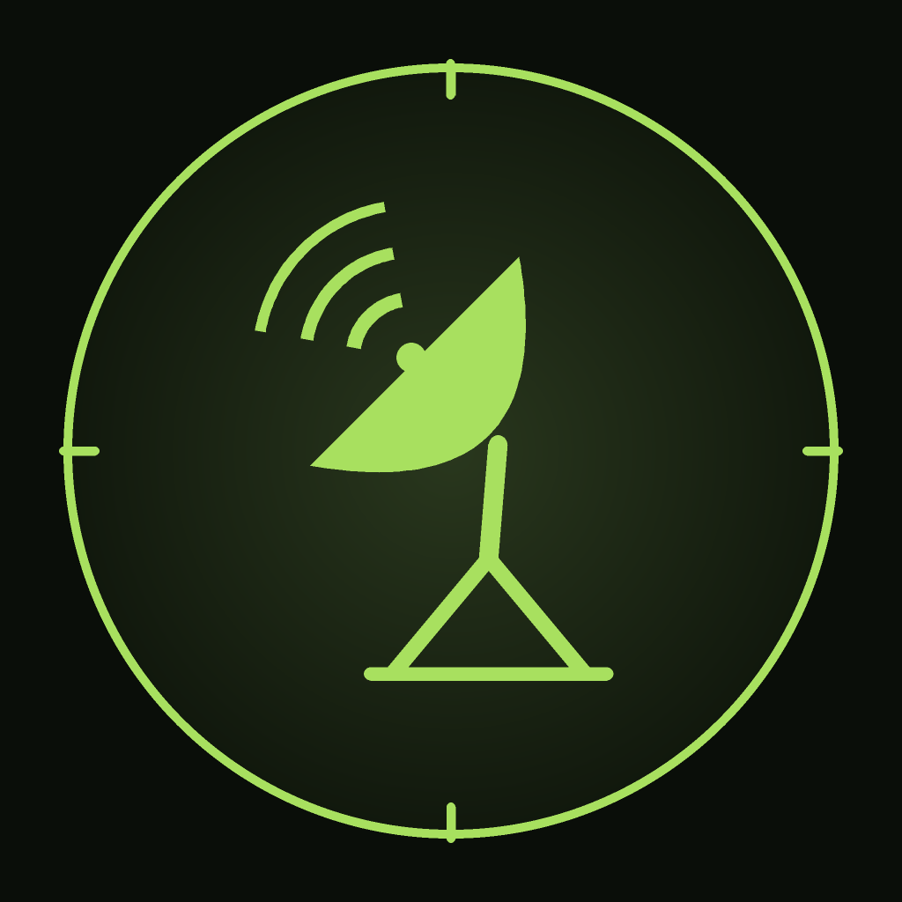
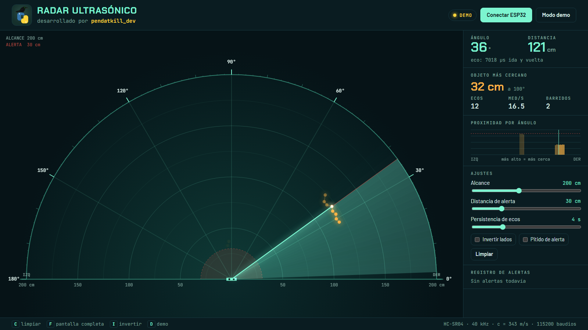

<p align="center">
  
</p>

<h1 align="center">My Radar</h1>
<p align="center">Radar ultrasónico con ESP32, visor web, visor de escritorio y app Android<br>by <b>pendatkill_dev</b></p>



Un sensor HC-SR04 montado sobre un servo SG90 barre 176° y mide la distancia a lo que tiene delante. El ESP32 envía cada medida por **USB**, **WiFi** y **Bluetooth LE**, y tres clientes la dibujan como una pantalla de radar:

| Cliente | Conexión | Carpeta |
|---|---|---|
| App Android **My Radar** (Flutter, estilo consola táctica) | WiFi o Bluetooth LE | [`my_radar_app/`](my_radar_app/) |
| Visor web (Chrome o Edge, sin instalar nada) | USB con Web Serial | [`visor_web/`](visor_web/) |
| Visor de escritorio (Python + pygame) | USB | [`visor_pc/`](visor_pc/) |

## Hardware

| Componente | Pin del ESP32 |
|---|---|
| Servo SG90 (señal) | GPIO 18 |
| HC-SR04 TRIG | GPIO 19 |
| HC-SR04 ECHO | GPIO 23, **a través de un divisor de tensión** |
| LCD 1602 I2C | SDA GPIO 21 · SCL GPIO 22 |

Probado con una Keyestudio ESP32 Plus (chip USB CH340).

> **ECHO a 5 V.** El HC-SR04 devuelve 5 V y los GPIO del ESP32 solo admiten 3,3 V. Pon un divisor `ECHO — 1 kΩ — GPIO23 — 2 kΩ — GND` o usa un HC-SR04P alimentado a 3,3 V.
>
> **Servo.** Aliméntalo con una fuente de 5 V aparte (GND común) y un condensador de 470–1000 µF. Sus picos de consumo pueden reiniciar el ESP32.

## Puesta en marcha

### 1. Firmware

Abre [`firmware/radar_esp32/radar_esp32.ino`](firmware/radar_esp32/radar_esp32.ino) en el IDE de Arduino.

- Placa: **ESP32 Dev Module** (core ESP32 2.x).
- Esquema de particiones: **Huge APP (3MB No OTA)**. Con WiFi y Bluetooth el programa ocupa 1,3 MB y no cabe en el esquema por defecto.
- Librerías: **ESP32Servo** (1.x con el core 2.x, 3.x con el core 3.x) y **LiquidCrystal I2C** de Frank de Brabander.

Con `arduino-cli`:

```sh
arduino-cli compile --fqbn esp32:esp32:esp32:PartitionScheme=huge_app firmware/radar_esp32
arduino-cli upload  --fqbn esp32:esp32:esp32:PartitionScheme=huge_app -p COM5 firmware/radar_esp32
```

Al arrancar, la LCD muestra durante unos segundos cómo conectarse.

### 2. App Android

Descarga el APK desde [Releases](../../releases) e instálalo, o compílalo:

```sh
cd my_radar_app
flutter pub get
flutter build apk --release
```

La app ofrece tres canales:

- **Bluetooth LE:** escanea y enlaza con «MyRadar». No hace falta emparejar.
- **WiFi:** el radar crea siempre la red `MyRadar` (IP `192.168.4.1`). Desde el menú de la app puedes darle tu WiFi de casa; entonces se une a ella y la app lo encuentra sola.
- **Simulación:** datos de prueba, sin radar.

### 3. Visor web

Abre [`visor_web/index.html`](visor_web/index.html) en **Chrome o Edge**, pulsa **Conectar ESP32** y elige el puerto USB. Arranca en modo demo.

### 4. Visor de escritorio

```sh
pip install pygame pyserial
python visor_pc/radar_pc.py            # detecta el puerto solo
python visor_pc/radar_pc.py --demo     # sin hardware
```

Cierra el Monitor Serie de Arduino antes de abrir cualquier visor: solo un programa puede usar el puerto a la vez.

## Protocolo

El ESP32 envía una línea de texto por medida, unas 15 por segundo:

```
angulo,distancia_cm
```

`angulo` va de 2 a 178 (180 = izquierda). `distancia_cm` vale `-1` si no hay eco o si está fuera de 2–200 cm.

| Canal | Detalles |
|---|---|
| USB | 115200 baudios |
| WiFi | TCP, puerto 3333. En la WiFi de casa, anuncio UDP `MYRADAR <ip>` cada 2 s en el puerto 3334 |
| Bluetooth LE | Servicio UART de Nordic `6e400001-b5a3-f393-e0a9-e50e24dcca9e`. Medidas por notificación en TX (`…0003`), órdenes por escritura en RX (`…0002`) |

Órdenes que acepta por cualquier canal, terminadas en salto de línea:

| Orden | Efecto |
|---|---|
| `WIFI\|<red>\|<clave>` | Guarda la WiFi de casa y reinicia |
| `WIFIOFF` | Olvida la WiFi de casa y reinicia |
| `INFO` | Responde `INFO ap=<ip> sta=<ip o ->` |

## Seguridad

La red propia `MyRadar` usa la clave por defecto `pendatkill`, que está publicada en este repositorio. Cámbiala en `CLAVE_AP` (firmware) y en `claveRedPropia` (`my_radar_app/lib/enlace.dart`) si vas a usar el radar fuera de casa. Las órdenes no requieren autenticación: cualquiera conectado a esa red o por Bluetooth puede cambiar la WiFi del radar.

## Estructura

```
firmware/radar_esp32/   Firmware del ESP32 (Arduino)
my_radar_app/           App Android en Flutter
visor_web/              Visor web con Web Serial
visor_pc/               Visor de escritorio en Python
docs/                   Imágenes del README
```

## Licencias

El código es de **pendatkill_dev** y se publica bajo licencia [MIT](LICENSE).

- **Tipografías de la app:** Saira Stencil One, Saira Condensed y Share Tech Mono, bajo la SIL Open Font License. Sus textos de licencia están en [`my_radar_app/assets/fonts/`](my_radar_app/assets/fonts/).
- **flutter_blue_plus:** la app usa esta librería para el Bluetooth. Es gratuita para uso personal, educativo y sin ánimo de lucro; el uso comercial necesita su licencia de pago.
